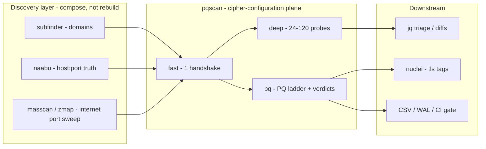
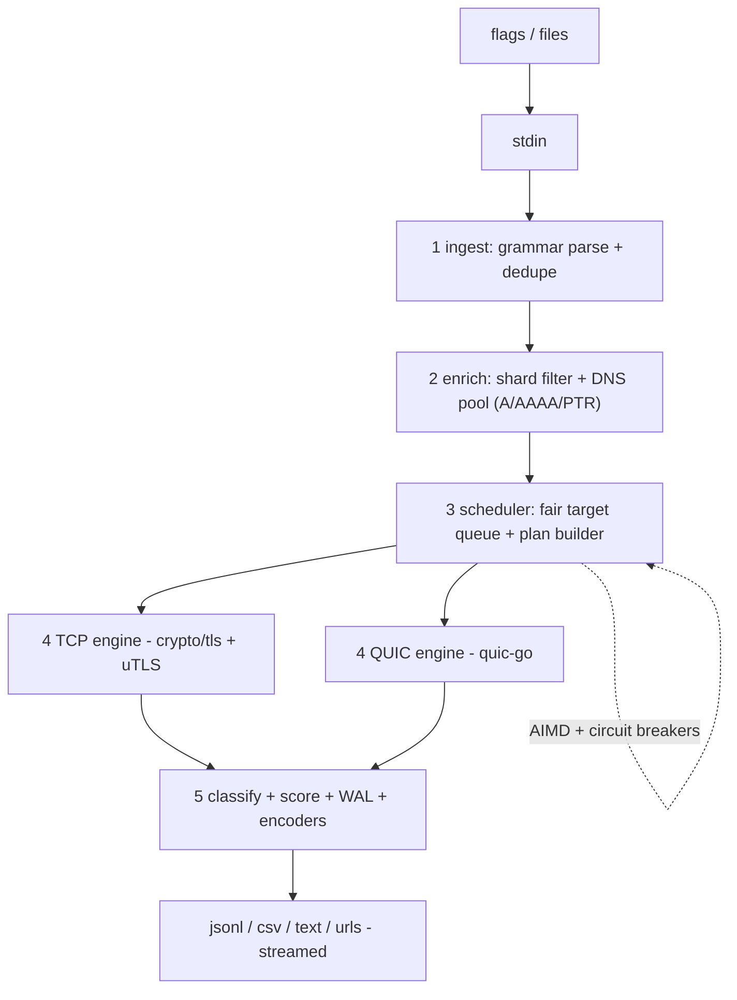
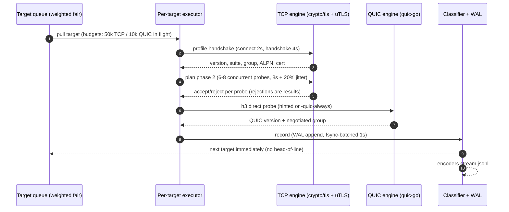
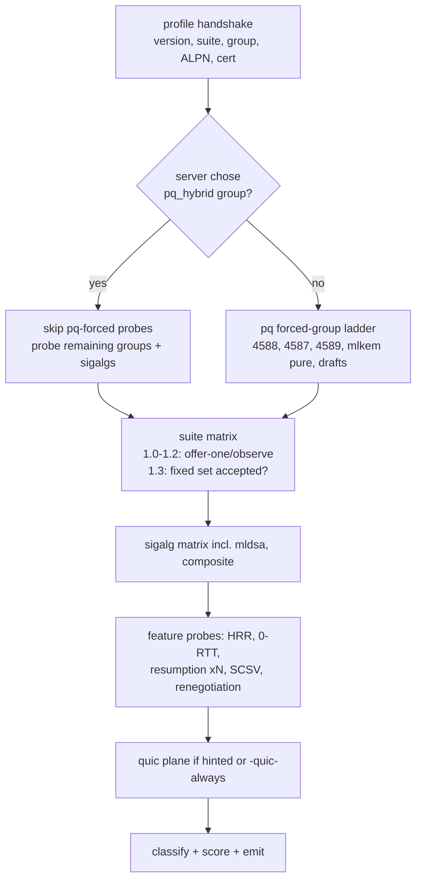

# pqscan — Product Requirements Document

## Spec card

| | |
|---|---|
| **Name** | `pqscan` |
| **One-liner** | A small binary that scans TLS and QUIC endpoints for cipher suites, protocol versions, key-exchange groups, signature algorithms and certificate properties — with a first-class post-quantum readiness view — and speaks the Project Discovery dialect (stdin → stdout, JSONL, chainable). |
| **Modelled on** | Capability breadth of cryptonice / gnutls-cli-debug; UX and chainability of httpx / nuclei / naabu. |
| **Runtime shape** | One static binary, no runtime deps, cross-compiled for linux/macos (amd64, arm64), Windows best-effort. |
| **Primary modes** | `fast` (single handshake per target), `deep` (gnutls-cli-debug-style exhaustive probing), `pq` (PQ-focused forced-group probing), `selftest`. |
| **Scale ambition** | Comfortable on a single domain; honest to a /24; viable for one box scanning a whole IPv4 /8; whole-internet fast-pass is supported as a documented multi-box recipe with shards. |

---

## 1. Problem statement

The 2024–2026 NIST PQC standardisation wave (FIPS 203 ML-KEM, FIPS 204 ML-DSA, FIPS 205 SLH-DSA, HQC selected 2025) moved post-quantum readiness from a lab topic into live TLS deployments: browsers already negotiate `X25519MLKEM768` by default, RFC 10024 registers the ECDHE-MLKEM hybrid groups, and ML-DSA / composite ML-DSA signature schemes and PQ certificates are entering registries and CAs. The transition is happening *in the cipher configuration layer* — exactly the layer security teams audit least often and tooling covers worst.

Today's tools split into three camps, and none fills the gap:

- **Exhaustive** (gnutls-cli-debug, testssl.sh, TLS-Scanner): excellent probe depth, but interactive, single-target, slow, and blind to PQC groups or awkward about them.
- **Fast/scalable** (zgrab2, masscan + follow-up): scale, but thin per-target TLS insight and no PQ classification.
- **Accessible** (cryptonice, sslscan): friendly output, but Python/Perl-based, serial per-target, not chainable, and pre-PQC.

There is no modern, fast, small, dependency-free tool that (a) enumerates cipher configuration exhaustively like gnutls-cli-debug, (b) classifies PQC readiness like a research paper's survey scripts, (c) pipes naturally into the subfinder → httpx → nuclei ecosystem, and (d) scales from one domain to a /16 without changing mental models.

`pqscan` is that tool.

## 2. Goals and non-goals

### Goals

- **G1 — Full TLS cipher-config enumeration (server side).** All protocol versions offered/probed (SSLv3 optional; TLS 1.0–1.3 core), all cipher suites testable suite-by-suite, key-exchange groups, signature algorithms, cert chain analytics — the gnutls-cli-debug probe set, re-thought for automation.
- **G2 — PQC classification as a first-class output.** Every negotiated or observed parameter is scored `pq | pq_hybrid | classic | obsolete`; a per-host readiness verdict with reasons; harvest-now-decrypt-later (HNDL) risk flag.
- **G3 — Full-protocol coverage: TCP TLS + QUIC.** TLS over TCP for HTTP/1.1 and h2 (ALPN-driven), and TLS 1.3 over QUIC (h3) on UDP/443, including PQ group negotiation inside QUIC.
- **G4 — Chainable like a Project Discovery tool.** Plain hosts, `ip:port`, URLs in on stdin; `-json/-jsonl/-csv` out on stdout; deterministic exit codes; pipe-in/pipe-out all the way.
- **G5 — Fast past any TLS tool today.** Multi-gigahertz handshake engine: ≥ 2,500 handshakes/s/core in fast mode; 100k+ in-flight connections; p95 per-target completion < 15 s in fast mode under load.
- **G6 — Small.** Single static binary ≤ 15 MB, no configuration required; `pqscan -u example.com` is a complete invocation.
- **G7 — Reverse-DNS-aware discovery.** Given IP ranges, enrich with PTR records and pick SNI candidates automatically, with multiple deduplicated SNI strategies.

### Non-goals (v1)

- Not a vulnerability scanner with exploit logic (heartbleed/ROBOT/CCS-injection classes ship as a *separate opt-in legacy module*, reusing classic public probe logic — they are not the reason the tool exists).
- No fuzzing, no downgrade/CVE classification reports in the style of security-metric dashboards; verdicts are configuration facts, not CVE claims.
- No browser-grade TLS stack mimicry beyond client-hello fingerprint presets (uTLS presets are in; JS-emulating fingerprints are out).
- No DTLS, SSH, SMB, VPN (IKEv2) cipher analysis in v1 (v2 candidates).
- No centralised intelligence: pqscan is the *point tool* in a pipeline, not a database.

## 3. Related work — honest survey

| Tool | What it does well | Why we are not building on it |
|---|---|---|
| **cryptonice** (F5 Labs) | Broad scan menu (TLS, HTTP, HTTP2, DNS, JARM), readable JSON report, sslyze-backed rigor | Python + async per-target model; not built for 10k/s fan-out; PQC groups/certs absent; not pipe-first |
| **gnutls-cli-debug** | Gold standard exhaustive per-protocol/per-suite probing of a single server | One target at a time; interactive; no scripting of probe matrix; no PQC groups |
| **testssl.sh** | Very complete suites + legacy protocols + vulnerability checks; portable bash | Shell; slow per target; PQC groups treated as opaque hex; output not pipeline-native |
| **sslyze** | Solid python TLS probing library, per-version suite enumeration | Python, serial; PQC gaps same as cryptonice |
| **zgrab2** | The scale champion: Go, modular scanners, banner grab, JSON, pipes into masscan/zmap | TLS probe depth is shallow by design (one/​few handshakes); no PQ classification; probe matrix not user-extensible |
| **masscan / zmap** | SYN-port discovery at insane rates | Not a TLS client; out of scope — they should feed pqscan (`masscan \| pqscan`) |
| **TLS-Scanner** (TUD) | Research-grade exhaustive protocol analysis | Academic codebase, not packaging/UX for ops use |
| **httpx / nuclei / naabu** | The chainability and output dialect, resume, stats, rate flags | Not TLS-deep (httpx does one handshake); nuclei's TLS data is template-shaped; naabu is only ports |
| **Censys / Shodan** | Mass passive TLS datasets incl. PQ group observations | Remote-only datasets; no active per-suite probing; no on-demand targeting |

**Synthesis rule.** Port discovery stays with naabu/masscan/zmap (compose, don't rebuild); host discovery stays with subfinder; HTTP content work stays with httpx; nuclei keeps its template engine. pqscan owns exactly one altitude: the *cipher-configuration plane* (TLS 1.x + QUIC handshake parameters, certificates, PQC classification) at speeds compatible with those neighbours.

## 4. Language decision: Go or Rust

Both are viable for a scanner of this shape. The decision matrix below is written so it can be re-scored at M0 (Section 10) when facts change.

### 4.1 Go

**What we get for free**

- crypto/tls ships ML-KEM by default (Go 1.24: `X25519MLKEM768` enabled by default; 1.25 exposes it in `ConnectionState.CurveID`; 1.26 adds `SecP256r1MLKEM768` / `SecP384r1MLKEM1024`) — the *negotiated* hybrid group is observable without any C bindings.
- TLS 1.0–1.2 client with explicit suite lists: per-suite "offer-one, observe-accept" probing is ~20 lines per probe natively.
- uTLS (`refraction-networking/utls`) gives ClientHello-level control — custom `supported_groups` lists, hand-set `key_share`, browser presets — which is precisely the probe mechanism for exotic/obsolete groups (`X25519Kyber768Draft00`, HQC/BIKE experimentals) that stock stacks refuse to construct.
- quic-go wraps crypto/tls, so the same group-control story applies to QUIC/h3.
- The PD ecosystem is Go: output conventions (streaming JSONL, `-stats`, `-resume`, shard semantics like zgrab2) are idiomatic patterns we can copy to the letter. Cross-compilation and goreleaser are one command.
- Contributor pool, speed of iteration, and MIT-signal licensing (MIT + explicit vendoring policy) suit this project.

**Costs / risks**

- GC pauses and per-connection memory overhead vs Rust at the same in-flight count (mitigated in Section 7 budgets; not decisive at our scale: handshakes are RTT-bound, not CPU-bound).
- crypto/tls's API boundary: some 1.2-era suites and all non-stdlib groups are invisible to stock stacks — handled via uTLS; SSLv2/SSLv3 are absent from Go entirely (optional -legacy sidecar, Section 8.4).
- One version trap to encode in CI: setting `Config.CurvePreferences` *replaces* defaults (a list without 4588 silently kills PQ), and `go < 1.24` tool lines revert PQ defaults. The CI matrix pins toolchain lines and asserts engine defaults, so the tool's probe truth is version-independent.

### 4.2 Rust

**What we get for free**

- rustls ≥ 0.23.22 has ML-KEM in core (`prefer-post-quantum` feature) plus the `rustls-post-quantum` crate (ML-DSA variants, aws-lc-rs provider); the provider API is the cleanest way in *any* stack to inject custom KEM groups — real advantage if we later want first-class HQC/BIKE probing as protocol citizens.
- No GC; deterministic tail latency; typically 2–3× smaller steady-state memory per connection; `io_uring`-based networking stacks exist for extreme-scale work.
- Single-binary sizes ~5–8 MB without effort.

**Costs / risks**

- TLS 1.0/1.2 legacy-suite enumeration in rustls is deliberately restricted; SSLv3-era probing would need vendored OpenSSL bindings (bloat, unsafe surface) — same sidecar problem as Go, worse ergonomics.
- QUIC coverage via quinn (rustls) exists, but crypto/tls-driven quic-go inherits Go's PQ defaults today; quinn's PQ story tracks rustls' (fine, but a moving target to pin in CI).
- Async (tokio) adds a second ecosystem to reason about in code review; per-probe cancellation (deep-mode thousands of short-lived handshakes) is where Rust async bugs breed.
- Slower iteration; smaller pool of contributors for a CLI tool whose main distribution channel is `go install`/Homebrew.

### 4.3 Verdict

**Go, with uTLS as the Hello-construction escape hatch, and quic-go for the UDP plane.** The binding constraint for a cipher scanner is *socket-parallelism and latency*, not per-connection CPU (Section 7's math), so Rust's throughput edge is mostly theoretical here; Go's ecosystem (PD conventions, goreleaser, crypto/tls MLKEM defaults, uTLS) buys the PD-like feel the PRD treats as a requirement. The Rust option stays scored in M0 and revisited only if real measurements show Go missing its throughput SLOs with no fix in reach. This choice is recorded with its kill-switch criteria so switching is a decision, not a vibe.

## 5. Feature set

### 5.1 Targeting and discovery

| Capability | Detail |
|---|---|
| Single target flags | `-u host`, `-u host:port`, `-u https://host`, `-cidr 192.0.2.0/24`, `ip:port` in one input grammar |
| List + stdin | `-l file`, stdin pipe (auto-detected), both mixed; dedupe (exact + recent-LRU) |
| Ports | `-p 443` default; comma list, ranges (`8000-8100`); per-port handshake plan |
| SNI strategies | `auto` (default): use SNI when hostname present; SNI-less IP probe otherwise; `ptr-then-ip`; `ip-only`; `strict-sni` (refuse non-matching certs for verdicts, still record them) |
| Reverse DNS | `-ptr` workers resolve PTR per IP (pooled UDP resolver, EWMA timeouts, negative cache) and promote the PTR hostname to SNI candidate; PTR is enrichment, never a blocker (never head-of-line blocking — Section 7.6) |
| Sharding / resume | `-shard i/n` like zgrab2; `-resume` from WAL; `-stats` live rate/error view |

### 5.2 Modes

- **`fast` (default):** one engineered handshake per (host, port): current browser-grade hello (uTLS preset, PQ-hybrid key share preferred) → observe negotiated parameters, cert chain, ALPN (h2 presence), features; optional one-shot HTTP probe (`-http`, off by default for raw IP sweeps, on for domain workflows).
- **`deep`:** computes a per-target probe *plan* and executes it (Section 7.4): version-by-version and suite-by-suite "offer-one / observe-accept" enumeration, group enumeration (native groups + uTLS-constructed exotic groups), signature-algorithm negotiation, HRR detection, resumption/ticket checks, 0-RTT acceptance, insecure-renegotiation and fallback-SCSV checks. Full-matrix opt-in (`-deep full`); default deep plan caps probes per target (24) with time budget.
- **`pq`:** forced-group probing — send hello containing *only* PQ-capable groups (`X25519MLKEM768`, `SecP256r1MLKEM768`, `SecP384r1MLKEM1024`, `MLKEM768`, `MLKEM512`-era drafts, obsolete Kyber drafts as a compat oracle), observe which the server accepts; offer PQ sig schemes (`mldsa44/65/87`, composite ML-DSA); classify certs; produce the readiness verdict. This is the mode to run across an estate on a calendar.
- **`selftest`:** exercises the tool's own handshake engines against an embedded instrumented endpoint, printing the local machine's TLS-stack capability matrix (useful for verifying what a fleet *can* reach, not just what servers offer). `serve` mode (instrumented endpoint as a long-running service) is deferred to v2.

### 5.3 Protocol coverage matrix

| Plane | Coverage in v1 |
|---|---|
| TLS over TCP | TLS 1.0, 1.1, 1.2, 1.3 full first-class; SSLv3 via legacy module (opt-in); SSLv2 out of scope until demand (record as TODO) |
| HTTP/1.1 over TLS | ALPN `http/1.1` + optional single GET probe (`-http`): status, server header, HSTS, Alt-Svc (h3 hint) |
| HTTP/2 over TLS | ALPN `h2` observation; optional negotiated-protocol HTTP probe |
| HTTP/3 / QUIC | TLS 1.3 inside QUIC v1 (RFC 9000) / v2 (RFC 9369) on UDP/443; PQ group negotiation observed via `ConnectionState` from quic-go; h3 verified by direct QUIC handshake (Alt-Svc used as a hint only — direct probe is truth) |
| QUIC modes | `fast-quic` single handshake; `deep-quic` group enumeration limited to stdlib-supported groups (v1); exotic-group construction inside QUIC deferred to v2 (forked TLS stack required) |

### 5.4 Handshake-engine capability checklist (client plane)

- Versions: force exact min/max; send-only-this-version probes (1.2-era).
- Suites: offer exact suite lists (single or sets) on 1.0–1.2; 1.3 suites fixed set, reported per-acceptance.
- Groups: `CurvePreferences` (stdlib groups incl. 4587/4588/4589); uTLS raw-extension mode for arbitrary group lists + explicit `key_share` per candidate (detects HRR precisely: server `hello_retry_request` presence is itself an observable).
- Sig algs: force `signature_algorithms` and `signature_algorithms_cert` lists (incl. PQ schemes).
- Features observed/verified: ALPN (http/1.1, h2, h3), extended master secret, session tickets, resumption via PSK (and resumption *rate* over N connections, cryptonice-parity), 0-RTT attempt + acceptance, fallback SCSV, renegotiation behaviour, compression check.
- Fingerprints: JA3/JA4 *of our own hello* (for transparency about what we sent), JARM of the server (optional flag), uTLS presets: Chrome/Firefox/Safari/iOS/Gotls.

### 5.5 Certificate analytics

- Full chain parse: subject/issuer, SANs, validity, key algorithm and size (RSA/ECDSA curve/Ed25519/Ed448), signature algorithm of every cert in chain, key-usage, SCT/CT presence.
- **PQC cert classes** via OIDs: ML-DSA-44/65/87 (RFC 9881 OIDs `2.16.840.1.101.3.4.3.17–19`), SLH-DSA, composite/hybrid cert drafts (composite ML-DSA cert types), plus ECDSA/RSA/other classification.
- Cross-observation: negotiated sig scheme vs cert sig alg (mismatches surfaced), issuer hierarchy PQ-readiness (is the CA itself PQ or classic — informs how long the leaf could realistically become PQ).

### 5.6 PQC classification and scoring

Classification tables live in generated code (Section 5.9), snapshot-sourced from IANA, so drift is a rebuild, not a survey.

- **KEX classes:** `pq_hybrid` (4585–4590, obsolete Kyber drafts labeled `pq_hybrid_draft`), `pq_pure` (MLKEM512/768/1024 pure groups), `classic` (X25519, P-256/P-384, FFDHE), `legacy` (SM2 hybrids noted, RSA kex, non-compliant groups).
- **Auth/sig classes:** same taxonomy over `mldsa44/65/87` (0x0904–0x0906), SLH-DSA schemes, composite ML-DSA schemes, dual-cert `dual_signature_algorithms` extension detection, classic RSA/ECDSA/EdDSA.
- **Readiness verdict (rubric, weights fixed in code + printable):**

| Signal | Points |
|---|---|
| PQ hybrid (or pure) KEX negotiated in *any* probed plane | 45 |
| PQ capability observable in offers (PQ groups in our forced probe accepted, PQ sig schemes or dual-cert signalling accepted) | 25 |
| Modern hygiene: TLS 1.3 + forward secrecy + no legacy versions/suites accepted | 15 |
| Certificate/chain PQ signal (PQ or composite cert, PQ-ready issuer) | 15 |

Verdict banding: **A+ ≥ 85, A ≥ 70, B ≥ 50, C ≥ 30, D < 30**, plus standalone boolean flags: `kex_pq`, `auth_pq_signal`, `cert_pq`, `hndl_risk` (classic-only KEX today ⇒ recorded traffic is decryptable by a future CRQC — the flag means "harvestable").

### 5.7 Output and chainability

**Dialect rules (non-negotiable):** stdin→stdout all the way; one JSON object per line in `-jsonl`/`-json`; human text default is single-line-per-target like httpx; `-csv` for spreadsheets; exit codes documented; a `--silent` that means *only results*.

- Grammar in: hostname, `host:port`, `ip`, `ip:port`, `scheme://host[:port]`, CIDR notation, and the three explicit parsers `-from-httpx` (httpx text mode lines), `-from-naabu` (`host:port`), and masscan stdin auto-parse. Raw pipes "just work" without a flag (first recipe below is two plain pipes).
- JSONL record (versioned `schema: 1`), full example (captured live on
  google.com; the machine-readable published schema lives at
  [`docs/schema-v1.json`](docs/schema-v1.json), generated from the goldens
  and drift-checked in CI):

```json
{"schema":1,"mode":"fast","target":{"input":"google.com","host":"google.com","ip":"","port":443,"ptr":"","sni_used":""},"handshake":{"negotiated":4588,"group_name":"X25519MLKEM768","group_class":"pq_hybrid","suite":"TLS_AES_128_GCM_SHA256","version":"tls-1.3","alpn_neg":"h2"},"quic":{"attempted":true,"state":"negotiated","negotiated":4588,"group_name":"X25519MLKEM768","group_class":"pq_hybrid","discovered":{"alt_svc_h3":true,"h3_direct":true}},"cert":{"sig_alg":"sha256WithRSAEncryption","sig_pq":false,"key_alg":"ECDSA","key_pq":false,"dual":false},"pq":{"score":40,"label":"pq-partial","hndl":false,"summary":"negotiated_pq_hybrid(+40)"},"error":""}
```

Block order is the encoders' contract (pinned by the goldens; the key order
in the JSONL matches):

| Block | Fields |
|---|---|
| `target` | `input`, `host`, `ip`, `port`, `ptr`, `sni_used` |
| `handshake` | `negotiated` (group id), `group_name`, `group_class`, `suite`, `version`, `alpn_neg` |
| `quic` | `attempted`, `state` (negotiated · handshaked · refused · mismatch · skipped · udp_blocked), `negotiated`, `group_name`, `group_class`, `discovered{alt_svc_h3, h3_direct}` (present when the hint plane ran) |
| `cert` | `sig_alg`, `sig_pq`, `key_alg`, `key_pq`, `dual` |
| `pq` | `score` (0–100), `label` (bands: `pq-ready` ≥ 80, `pq-ready-hybrid` ≥ 60, `pq-partial` ≥ 40, `pq-missing` ≥ 1; a scan-error surfaces as 0 with `error`), `hndl` (the harvest-now-decrypt-later flag on an obsolete-draft acceptance), `summary` (the rule trail) |
| `deep` | deep mode only: `mode` (standard · full), `attempted`, `ok`, `rejected`, `findings[]{probe, result (accepted · rejected · refused · error), detail}` |
| `error` | per-target error string (an unreachable endpoint is a record, not a process failure) |

The CSV form is the flat 25-column projection of the same record (the header
order is the contract, also pinned by the goldens): `target, host, port,
ptr, sni, negotiated, group_name, group_class, suite, version, alpn,
quic_state, quic_group, udp_blocked, cert_sig_alg, cert_sig_pq,
cert_key_alg, cert_key_pq, cert_dual, pq_score, pq_label, pq_hndl,
pq_summary, error, ts`.

- Flags: `-json`, `-jsonl`, `-csv`, `-text`, `-o file`, `-urls` (emit `scheme://host:port` for nuclei), `-fields` selection, `-certs-dir` (write end-entity PEMs for later tooling), `-stream` (unordered streaming, default) vs `-sorted` (buffered ordering by input for human review).
- Chain examples (verbatim reference implementations, Section 6).

### 5.8 Concurrency and performance architecture

*(Full treatment in Section 7 — called out here because it is a product requirement, not an implementation note: the tool's identity is "small and fast", and the pipeline is designed before the probes are.)*

## 6. Chaining reference implementations



The point-tool contract, shown concretely. All commands are runnable verbatim; `pqscan` treats upstream output as input lines and never requires a flag unless a format needs disambiguation.

- **subfinder → pqscan (direct, it's just names):**

```bash
subfinder -d example.com -silent | pqscan -mode fast -jsonl -o assets.jsonl
```

- **subfinder → httpx → pqscan (keep only live HTTPS endpoints):**

```bash
subfinder -d example.com -silent \
  | httpx -silent -ports 443,8443 -p 443,8443 -no-color \
  | pqscan -mode deep -jsonl -o deep.jsonl
```

  (httpx text-mode lines are host-URI-ish; the built-in parser strips scheme/status decorations. `-from-httpx` exists for httpx `-csv` output whose lines start with url,status.)

- **naabu (port truth) → pqscan (cipher truth):**

```bash
naabu -l domains.txt -p 443,8443,465,993 -silent \
  | pqscan -from-naabu -mode fast -jsonl
```

- **masscan/zmap (internet-scale port discovery) → pqscan (TLS/PQC pass):**

```bash
masscan -p 443 -iL cidrs.txt --rate=100000 --open-only -oX - \
  | pqscan -shard 1/4 -mode fast -ptr -rate 20000 -jsonl -o shard1.jsonl
```

- **Output → jq triage (who is NOT pq-ready):**

```bash
pqscan -l estate.txt -mode pq -jsonl \
  | jq -r 'select(.pq.verdict != "A+" and .pq.verdict != "A") | [.target.host, .pq.verdict, (.pq.reasons|join("; "))] | @tsv'
```

- **Output → nuclei (only h2-speaking, pq-ready hosts):**

```bash
pqscan -l assets.txt -mode fast -urls \
  | nuclei -silent -tags tls
```

- **Whole-organization PQ calendar job:** weekly `pqscan -l targets.txt -mode pq -jsonl | diff yesterday.jsonl -` or run in CI against a pinned list; pqscan's deterministic ordering (`-sorted`) makes diffs meaningful.

## 7. The hard part: async architecture and throughput (first-class)

A cipher scanner is not a web scraper: the work is thousands of *short, RTT-dominated, failure-rich* network round-trips whose failures carry information (a rejection is a result). The architecture exists to make the *failure case* and the *tail* fast, not just the happy path.

### 7.1 Model first: where time actually goes

Per fast-mode handshake, end to end:

```
L ≈ connect_rtt (1) + tls13_handshake_rtt (1)   [2-RTT floor; TLS 1.2 = 2 handshk RTT]
    + server_compute (~50–300 ms typical, CDN edge; +1 RTT when HRR required)
    + client_crypto (MLKEM-768 encap ~0.05–0.15 ms; negligible)
```

At RTT 60 ms: L ≈ 170–400 ms. Throughput for a pool of W concurrent connections is `T ≈ W / L` — *not* cores × something. Concretely: W = 50,000 in-flight, L = 0.3 s ⇒ ~165k handshakes/s ceiling, of which real-world caps (DNS, dial syscalls, client crypto + GC, etiquette) bind first. Client-side crypto is ~0.2–0.6 ms/handshake in Go ⇒ CPU-bound ceiling ≈ 2–4k handshakes/s/core. **Conclusion: the design is a bounded-parallel pipeline with W tuned to the CPU and ethics caps, and the language choice is not the bottleneck.** This math drives every budget below and is re-measured, not assumed, in M0.

### 7.2 Pipeline shape (five stages, all bounded, all streaming)



Design rules:

- **No stage ever blocks its producer on a slow individual item.** Each stage is a goroutine pool pulling from a bounded channel. Ingest never waits on DNS; the scheduler never waits on a handshake; the encoder never waits on a handshake (WAL absorbs, then encoders drain).
- **No unordered goroutine explosion.** Concurrency is expressed as worker pools over channels with explicit budgets (next section), not "goroutine per target with unlimited fan-out".
- **Everything streams by default.** Results are emitted the moment a target's plan completes; `-sorted` is the only buffered mode.
- **Cancellation is pervasive.** Every probe has a deadline ladder; every stage honours context cancellation; Ctrl-C drains, the WAL remains consistent, exit code 130.

### 7.3 Budgets and fairness (the numbers that make it fast *and* safe)

| Budget | Default | Rationale |
|---|---|---|
| Global in-flight connections | 50,000 (CPU-tuned by startup probe on the box) | `T ≈ W/L`; 50k ⇒ ~2 GB RAM with 20–40 KB/conn |
| TCP in-flight | 40k | quic-go needs more RAM per conn |
| QUIC in-flight | 10k | per-conn goroutines + timer wheel are heavier |
| Deep-mode probes per target (concurrent) | 6–8 | one host ≠ 64 handshakes at once; be a polite neighbour, avoid server-side rate kicks |
| Per-subnet (/24) concurrent | 64 | NAT/policy devices fail closed; breakers catch the rest |
| Global rate cap | 20k handshakes/s (`-rate` for more) | etiquette default; internet recipes use ≤ 5 conns/IP/s |
| DNS in-flight | 256 (pooled resolver × EWMA) | PTR storms must not starve handshakes — separate budget |
| Handshake deadline ladder | connect 2 s / handshake 4 s / probe-total 8 s (±20 % jitter) | jitter de-synchronises retries; ladder bounds the tail |
| Retries | 1, transient-only (RST/timeout), never for protocol rejections | rejections are results, not errors |
| Result channel | 10k entries before backpressure | WAL keeps flushes off the hot path |

**Adaptive concurrency (AIMD) + circuit breakers.** Global W ramps from 1k toward its cap; on error-rate spikes (timeout/conn-fail ratio) it halves, and recovers additively on success streaks. Per-/24 and per-ASN breakers: K consecutive timeouts ⇒ bucket cools for minutes; results from cooled buckets are `skipped` with reason (never silent). Target queue is `weighted-fair` so one pathological /24 cannot starve the run.

**Fairness inside a target (deep mode).** Per-target plans execute with a local scheduler: probes are cheap stateless handshakes, so depth is bounded by *plan length × per-probe latency*, not by any lock or queue; probe results feed the plan builder (Section 7.4) which prunes redundant probes in-flight.



### 7.4 Deep-mode scheduling (the probe-plan DAG)



- Phase 1 is one handshake; its result prunes phase 2 (e.g., a suite already negotiating is skipped; groups the server re-routed via HRR are marked).
- Default plan ≤ 24 probes/target; `-deep full` unlocks ~120.
- The PQ ladder is run even on `classic` servers because "does their stack accept 4588 when forced" is the actionable estate-wide fact.

### 7.5 QUIC engine specifics

- quic-go v0.5x with `tls.Config` sharing the same group/sig control story as TCP; version v1/v2, ALPN `h3`.
- QUIC probes trigger on: explicit `-quic-always`, `-quic` on domain workloads, or an Alt-Svc h3 hint from fast mode. Raw-internet mode does QUIC only for hinted hosts by default (UDP half-open scans elsewhere are a v2 idea, not the default).
- In-flight budget separate (10k) because quic-go's per-conn goroutine + timer cost ≈ 5× TCP; measured at M2, budget auto-derived at startup (like TCP's).
- UDP-outbound-blocked networks detected in probes ⇒ `udp_blocked` reported rather than retried.

### 7.6 No head-of-line anywhere (the discipline list)

DNS/PTR enrichment never delays the handshake stream (SNI-less IP handshakes run in parallel; PTR result upgrades the record if it lands in time — `-sni ptr-then-ip` re-handshakes only when the PTR arrives after the initial SNI-less attempt reported a "default cert" mismatch risk). Encoders never wait on disk: WAL is append-only, fsync-batched (every 1,000 records or 1 s). The scheduler never waits on a slow *target* (plans finish via deadlines). The *tool* never waits on the *last* slow target (Ctrl-C drains in ≤ deadline-ladder seconds). `-resume` replays the WAL: completed-target set is a compact on-disk set (exact until 4 M entries, then spilled), so an internet pass interrupted at hour four resumes in seconds.

### 7.7 Memory, allocation, GC discipline

- Handshake buffers via `sync.Pool` (4–16 KB), pre-sized hello templates per fingerprint preset; codepoint→name maps as static arrays, no Sprintf in the hot path.
- JSONL encoder is hand-rolled for the hot record (no reflection): ~3× less alloc than `encoding/json` marshal paths.
- `GOMEMLIMIT` set by default from the W budget; `GOGC` 300; optional `GOGC=off` + `FreeOSMemory` in long internet passes (benchmarked before M5, not by taste).
- Target: < 4 GB RSS at 50k TCP + 10k QUIC in-flight including result/WAL buffers — measured in CI perf suite (Section 10.3).

### 7.8 Benchmarks and SLOs (CI-enforced)

| Metric | SLO (measured, M0/M2/M3) |
|---|---|
| fast-mode handshakes/s/core vs cloudflare.com | ≥ 2,500 |
| fast-mode aggregate, 16 cores, rate 20k/s | sustained 30 min, W stable |
| deep-mode probes/s (mixed real hosts) | ≥ 100 |
| `deep` full-matrix per host, 60 ms RTT | ≤ 25 s p50 |
| QUIC handshakes/s/core | ≥ 1,000 |
| p95 per-target completion, fast mode under load | < 15 s |
| RSS @ 50k/10k in-flight | < 4 GB |
| Resume replay of a 10 M-record WAL | < 60 s |

Comparative baselines recorded at M3: zgrab2, sslyze, cryptonice, gnutls-cli-debug (per-target depth), httpx (raw churn). We publish the harness and numbers, and expect to lose to zgrab2 on raw churn while winning decisively on per-target depth at chainable scale.

## 8. CLI surface

- `pqscan -u example.com` — the zero-configuration entry.
- Targeting: `-u`, `-l`, `-cidr`, `-p`, `-from-httpx`, `-from-naabu`, `-shard i/n`, `-resume`
- Modes: `-mode fast|deep|pq|selftest`, `-deep standard|full`, `-quic`, `-quic-always`, `-http`
- Probes: `-probe-suite`, `-probe-version`, `-probe-group`, `-probe-sigalg` (force sets), `-client-fingerprint chrome|firefox|safari|ios|gotls`, `-ja4`, `-jarm`
- TLS knobs: `-sni auto|ptr-then-ip|ip-only|strict-sni`, `-ptr`, `-no-ptr`, `-timeout`, `-connect-timeout`, `-retries`, `-verify`, `-ca-bundle`
- Performance: `-threads` (engine workers), `-c` (in-flight cap), `-rate`, `-dns-threads`, `-stats`, `-no-color`
- Output: `-json`, `-jsonl`, `-csv`, `-urls`, `-text` (default), `-o`, `-fields`, `-certs-dir`, `-silent`, `-stream`/`-sorted`
- Legacy module: `-legacy module=heartbleed,ccs,robot,sslv3` (opt-in, off by default)
- Config: `-config pqscan.yaml` (org profiles: default ports, budgets, probes, output path); env overrides `PQSCAN_*`; `-h2c`/`-http2` never needed (ALPN is automatic).

## 9. Milestones

| # | Milestone | Acceptance criteria |
|---|---|---|
| M0 | Engine spike + measurement report | crypto/tls + uTLS capability matrix proven (group forcing incl. 4588 + HRR observation; suite forcing); quic-go handshake with group control working; throughput microbench ≥ 2.5k/s/core; **Go-vs-Rust decision re-scored with numbers** |
| M1 | fast mode + output dialect | grammar-in (hosts/naabu/httpx/masscan), fast handshakes on TCP, JSONL/text/csv/urls out, exit codes, `-stats` |
| M2 | PQC classification + deep mode | IANA regen pipeline live, scoring rubric + verdicts, deep plan executor (≤ 24-probe default), sig-alg + cert PQ analytics, differential correctness vs gnutls-cli-debug on fixture matrix |
| M3 | Scale hardening | budgets/AIMD/breakers as specced, WAL resume, SLO suite green in CI, shard mode |
| M4 | QUIC plane + enrichment | h3 via direct QUIC handshake, PQ-in-QUIC observed, PTR pool + SNI strategies, `-certs-dir` |
| M5 | Release | goreleaser static binaries (linux/macos amd64+arm64, 1 MB–15 MB), docs, JSON schema published, fixture matrix results published, `-deep full` verified against badssl + PQC ground-truth hosts |

Sequencing rule: M0 is the measurement and decision gate; each subsequent milestone depends only on its predecessor's acceptance criteria.

## 10. Test and verification strategy

**Test-first is the merge gate ([ADR-0002](../blob/main/docs/adr/0002-watched-red-merge-gate.md)):** every behavioural change lands as a watched RED→GREEN pair — the failing test exists and runs before the implementation, the RED output is recorded verbatim in the PR body, and CI re-proves the green suite. Rejections and observations of hostile input are results; their tests are fixtures first.

### 10.1 Correctness fixtures

- **badssl.com subdomain matrix** (expired, untrusted, suite-hostile, version-hostile, mismatch, RC4/3DES hosts) — expected results checked per probe; regressions fail CI.
- **PQC ground truth:** Google-hosted and Cloudflare-hosted PQ test endpoints (known 4588-negotiating), a local OpenSSL/BoringSSL TLS 1.3 config matrix *as fixtures we own* (suite/group/sigalg per config), local Go servers serving ML-DSA/composite certs where registries permit.
- **Differential:** gnutls-cli-debug + sslyze vs pqscan on the fixture matrix — verdicts must agree or a written exception documents *why* ours is correct (e.g., PQ groups gnutls can't construct).

### 10.2 Protocol truth

- QUIC results validated with Wireshark-visible handshakes on fixtures; h3 presence cross-checked against Alt-Svc (mismatches reported explicitly: "Alt-Svc says h3, direct QUIC says no" is a finding, not an error).
- TLS-version/suite decisions double-checked against raw hello parsing when uTLS and crypto/tls disagree.

### 10.3 Performance and resilience

- CI perf suite (Section 7.8 SLOs) against a local multi-port TLS server farm + controlled-latency container (`tc`), no external network dependence.
- Chaos probes: mid-handshake RST floods, black-holing, resolver failures, WAL unmount — invariants: no crash, WAL consistent, resume replays, breakers trip and recover.

### 10.4 Ethics and rate safety (shipped, documented)

- Conservative defaults (rate 20k/s, per-subnet concurrency, jitter, breaker cool-downs); `-aggressive` documented for controlled environments.
- README section: legal/ethical notes for mass scanning, opt-out contact, honest framing per zmap/masscan practice. Users own their scans; the tool enforces politeness by default, not by policy enforcement fantasies.

## 11. Risks and mitigations

| Risk | Mitigation |
|---|---|
| crypto/tls/uTLS drift or API changes break group forcing | M0 pins both stacks; CI runs the capability matrix nightly; vendor-lock fences in go.mod; IANA regen pipeline makes codepoint drift a rebuild |
| SNI-less IP handshakes return CDN default certs → misleading verdicts | `-strict-sni` verdict flag; SNI-less records carry `sni_used=false` and get verdict-badged `provisional` unless strict mode |
| Middleboxes choke on large PQ ClientHello (tldr.fail class) | Recorded as `clienthello_too_large` observed state; fast mode can fall back to classic hello and re-probe (flag `-pq-fallback`, default on fast mode for raw IP scans) |
| quic-go budget blowout on internet scale | Separate QUIC budget, hint-gated probing, M2 measurements drive W_q |
| Deep mode on millions of hosts is nonsense time | Explicit guidance + `-mode fast` default; docs include the sampling recipe (deep on top-N ASNs, fast everywhere); rate/etiquette docs |
| Legal/abuse of mass scanning | Defaults + docs per Section 10.4; no bundled 'internet scan' one-liner; shard support but the user owns the ethics |
| Single-maintainer risk | MIT, small module surface, probe matrix as data (not code) so contributors add probes without touching engines |

## 12. Success metrics

- **Adoption:** used as the TLS/PQC stage in real chains (GitHub stars is not one — watch: external issues, recipe PRs).
- **Correctness:** fixture-matrix pass rate 100 %; differential exceptions documented and < 5 % of categories.
- **Performance:** SLO table green in CI at M3+; real-world: one box, fast mode, 10 M targets < 24 h at default caps.
- **Utility:** estate calendar job (mode `pq`) produces diff-able verdicts adopted by at least one organisation, beginning with the maintainers' own estate.

## 13. Repository layout (initial)

```
pqscan/
  cmd/pqscan/            # main, flag plumbing, config
  internal/tlsx/         # tcp+utls client, hello templates
  internal/quicx/        # quic-go engine
  internal/probe/        # probe plans, executors, deadline ladder
  internal/classify/     # IANA regen tables, taxonomy, scoring
  internal/resolver/     # DNS pool, PTR, caches
  internal/target/       # grammar, dedupe, shard, resume set
  internal/out/          # encoders (jsonl/csv/text/urls), WAL
  internal/legacy/       # optional module (heartbleed/ccs/robot/sslv3)
  build/                 # release packaging (goreleaser), CI perf harness
  docs/spec.md           # this document (repo master)
  tests/fixtures/        # server configs, badssl expectations, IANA snapshots
```

## Appendix A. PQC codepoint reference (snapshot)

*(Snapshot dated 2026-10-15 from IANA TLS Parameters; the build regenerates from the registry CSV — the table must never be hand-edited in code.)*

Supported groups (TLS 1.3 plane):

| Value | Name | Class |
|---|---|---|
| 4585 | SecP256r1MLKEM512 | pq_hybrid |
| 4586 | MLKEM512X25519 | pq_hybrid |
| 4587 | SecP256r1MLKEM768 | pq_hybrid (RFC 10024) |
| 4588 | X25519MLKEM768 | pq_hybrid (RFC 10024, Recommended) |
| 4589 | SecP384r1MLKEM1024 | pq_hybrid (RFC 10024) |
| 4590 | curveSM2MLKEM768 | hybrid (SM2 family) |
| 513/514 | MLKEM768 / MLKEM1024 (pure) | pq_pure (draft-ietf-tls-mlkem) |
| 25497 | X25519Kyber768Draft00 | pq_hybrid_draft (OBSOLETE — compat oracle) |
| 25498 | SecP256r1Kyber768Draft00 | pq_hybrid_draft (OBSOLETE — compat oracle) |

Signature schemes: `mldsa44(0x0904)`, `mldsa65(0x0905)`, `mldsa87(0x0906)` (draft-ietf-tls-mldsa); SLH-DSA schemes (draft-reddy-tls-slhdsa, FIPS 205); composite ML-DSA family (draft-reddy-tls-composite-mldsa); dual-cert `dual_signature_algorithms` extension (draft-yusef-tls-pqt-dual-certs). Certificate OIDs: ML-DSA-44/65/87 = `2.16.840.1.101.3.4.3.17–19` (RFC 9881). Key standards: FIPS 203/204/205; TLS 1.3 = RFC 9846; hybrid design framework = draft-ietf-tls-hybrid-design; QUIC v1 = RFC 9000, QUIC v2 = RFC 9369; HQC (KEM, selected 2025) — watchlist, no codepoint yet.

## Appendix B. Naming

`pqscan` — 6 letters, one grep-able token, sits in the PD tool namespace grammar (`httpx`, `nuclei`, `naabu`, `katana` — short, one-word, lowercase). Retained as the working name; the `pq` mode reads as the focus.
