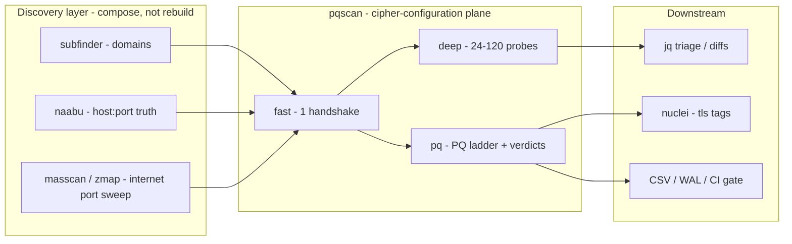

# Recipes — chaining with the Project Discovery toolset

Design source: [`docs/spec.md#6-chaining-reference-implementations`](https://github.com/shsingh/pqscan/blob/main/docs/spec.md#6-chaining-reference-implementations) — runnable verbatim; `pqscan` treats upstream output as input lines and needs no flag unless a format requires disambiguation.



## Domain discovery → cipher truth

```bash
subfinder -d example.com -silent | pqscan -mode fast -jsonl -o assets.jsonl
```

```bash
subfinder -d example.com -silent \
  | httpx -silent -ports 443,8443 -p 443,8443 -no-color \
  | pqscan -mode deep -jsonl -o deep.jsonl
```

(httpx text-mode lines parse unflagged; `-from-httpx` exists for httpx `-csv` output whose lines start with url,status.)

## Port truth first

```bash
naabu -l domains.txt -p 443,8443,465,993 -silent \
  | pqscan -from-naabu -mode fast -jsonl
```

## Internet scale (one shard of a four-box pass)

```bash
masscan -p 443 -iL cidrs.txt --rate=100000 --open-only -oX - \
  | pqscan -shard 1/4 -mode fast -ptr -rate 20000 -jsonl -o shard1.jsonl
```

## Estate PQ calendar job (who is not PQ-ready)

```bash
pqscan -l estate.txt -mode pq -jsonl \
  | jq -r 'select(.pq.verdict != "A+" and .pq.verdict != "A") | [.target.host, .pq.verdict, (.pq.reasons|join("; "))] | @tsv'
```

Weekly cadence makes the diff meaningful: `pqscan -mode pq -sorted -jsonl | diff yesterday.jsonl -`.

## Feed nuclei

```bash
pqscan -l assets.txt -mode fast -urls | nuclei -silent -tags tls
```

## Reverse-DNS workflow (IP ranges in, domains out)

Given an IP range, `-ptr` resolves PTR records with a pooled resolver and
promotes the PTR hostname to the SNI candidate (`-sni ptr-then-ip`):

```bash
pqscan -cidr 198.51.100.0/24 -ptr -sni ptr-then-ip -mode fast -jsonl
```

Bulk PTR enumeration at massive scale stays with massdns/zdns: pre-filter
there, hand the FQDNs to `pqscan`.
